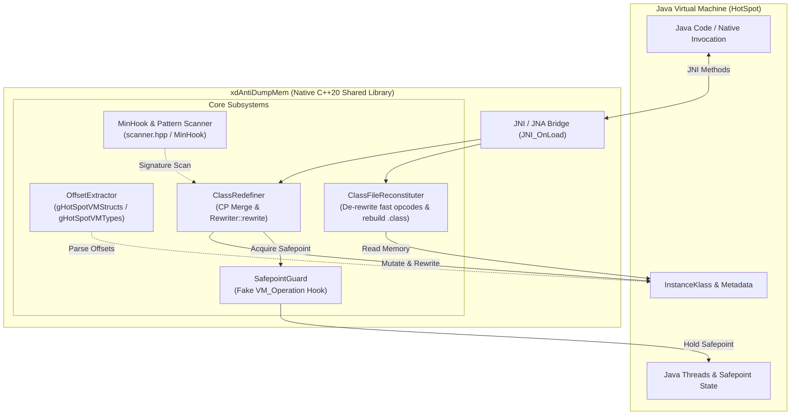

# xdAntiDumpMem (Custom JNA)

<p align="center">
  <b>High-Performance C++20 HotSpot JVM Runtime Introspection, Bytecode Reconstituter & Class Redefiner</b>
</p>

<p align="center">
  <a href="README.md"></a>
  <a href="README_RU.md"></a>
  
  
  
  
</p>

---

## 🌐 Language Navigation
- **English**: [README.md](README.md)
- **Русский**: [README_RU.md](README_RU.md)

---

## 📖 Overview

**xdAntiDumpMem** (internally referenced as `custom_jna`) is a low-level native library written in modern C++20 for Windows x64. It interfaces directly with **OpenJDK HotSpot VM** (versions 17 through 21+) internals without relying on debug builds or standard JVMTI restrictions.

It is designed for reverse engineers, security researchers, and runtime instrumentation systems who need to:
1. **Defeat Anti-Dump Protections & Dump In-Memory Classes**: Reconstruct pristine, valid, and decompileable `.class` byte arrays directly from live JVM memory (`InstanceKlass`), reversing HotSpot-internal optimized bytecodes (`fast_*`) back to standard JVM specification opcodes.
2. **Arbitrary Runtime Class Redefinition**: Hot-patch loaded classes directly in memory, safely synchronizing threads via an internal HotSpot `SafepointGuard`, merging Constant Pools, and invoking HotSpot's internal `Rewriter::rewrite`.
3. **Direct Memory Access (JNA Engine)**: Read and write primitive and object reference fields (both instance and static) directly by memory offset, bypassing Java Reflection, access modifiers (`private`/`final`), and security checks.
4. **Dynamic JVM Flag & Verifier Control**: Query and modify HotSpot flags at runtime (e.g., toggle bytecode verification).

---

## 🏛️ Architecture



---

## ✨ Key Features

### 1. Dynamic VMStructs Offset Discovery
Instead of hardcoding memory offsets that break between minor JDK updates, `xdAntiDumpMem` dynamically inspects the HotSpot exports `gHotSpotVMStructs` and `gHotSpotVMTypes` inside `jvm.dll`.
- Automatically maps OOP layouts: `InstanceKlass`, `ConstantPool`, `ConstantPoolCache`, `Method`, `ConstMethod`, `Symbol`, `Array<T>`.
- Fully supports modern OpenJDK compact field metadata (`FieldInfoReader` for `fieldinfo_stream` introduced in recent JDK releases).

### 2. Full Class File Reconstitution (`klassReconstruct`)
When Java classes run inside HotSpot, the JVM rewrites standard bytecodes into internal "quick/fast" opcodes (e.g., `_fast_agetfield`, `_fast_invokevfinal`, `_fast_linearswitch`, `_fast_aload_0`) and alters constant pool references. Standard memory dumpers produce corrupt bytecode that cannot be decompiled.

`ClassFileReconstituter` restores the class file structure:
- **Bytecode Un-rewriting**: Translates fast HotSpot instructions back into standard Java bytecode specification opcodes (`getfield`, `putfield`, `invokevirtual`, `invokespecial`, `tableswitch`, etc.).
- **Constant Pool Assembly**: Emits all constant pool tags (`Utf8`, `Integer`, `Float`, `Long`, `Double`, `Class`, `String`, `Fieldref`, `Methodref`, `InterfaceMethodref`, `NameAndType`, `MethodHandle`, `MethodType`, `Dynamic`, `InvokeDynamic`).
- **Class Attributes**: Reconstructs `Code`, `LineNumberTable`, `Exceptions`, `InnerClasses`, `EnclosingMethod`, `NestHost`, `NestMembers`, `PermittedSubclasses`, and `Record` attributes.

### 3. Safe Runtime Class Redefinition (`klassRedefine`)
Hot-redefines classes without standard JVMTI / Java agent limitations:
- **`SafepointGuard`**: Mutating live classes from a JNI thread while worker threads execute bytecode causes crashes. `SafepointGuard` halts all Java threads by calling HotSpot's internal `SafepointSynchronize::begin()` and `end()` using signature patterns. To prevent crashes from null operations, it crafts a fake `VM_Operation` (type 42 `RedefineClasses`) satisfying HotSpot's internal virtual table calls.
- **Constant Pool Merging**: Appends new constant pool items to the active pool, maintaining backward indices.
- **LDC Index Widening**: Rewrites `ldc` instructions to `ldc_w` whenever constant pool growth pushes indices beyond 255.
- **Native Rewriter Invocation**: Locates HotSpot's native `Rewriter::rewrite(InstanceKlass*, Thread*)` via pattern scanning to re-link constant pool caches.

### 4. Direct Memory JNA Operations
A fast direct C function table (`JNINativeAccess_`):
- `findClass`, `findFieldId`, `findMethod`
- Fast typed field get/set: primitives (`int`, `long`, `float`, `double`, `boolean`, `byte`, `char`, `short`) and `object` references for both instance and static fields.
- Toggling bytecode verifier runtime flags (`setKlassBytecodeVerification`).

---

## 🛠️ Building the Project

### Prerequisites
- **Operating System**: Windows 10/11 x64
- **Toolchain**: MSVC v143 (Visual Studio 2022) with C++20 support
- **Build System**: CMake 3.20+ (CMake 4.0 supported)
- **JDK**: Java Development Kit 17 or 21+ (x64)

### Build Steps

Using PowerShell:
```powershell
# Clone the repository
git clone https://github.com/dino939/custom_jna.git
cd custom_jna

# Configure build directory
cmake -B build -S . -DCMAKE_BUILD_TYPE=Release

# Compile shared library (DLL)
cmake --build build --config Release
```

The resulting library `xdAntiDumpMem.dll` will be located in `build/Release/`.

---

## 🚀 Usage

### 1. Java JNI Interface Binding

When loaded into a Java process via `System.loadLibrary("xdAntiDumpMem")` or `System.load(...)`, `JNI_OnLoad` binds to either `das.ist.denger.systems.jvm.JvmInterface` or `org.example.Main`.

#### Java Wrapper Example:
```java
package das.ist.denger.systems.jvm;

import java.io.FileOutputStream;
import java.io.IOException;

public class JvmInterface {
    static {
        System.load("D:/cpp-projects/Jvm-api/build/Release/xdAntiDumpMem.dll");
    }

    // Dumps live in-memory class as clean .class byte array
    public static native byte[] klassReconstruct(Class<?> klazz);

    // In-memory redefines the class with new bytecode
    public static native boolean klassRedefine(Class<?> klazz, byte[] newBytes);

    public static void main(String[] args) throws IOException {
        // Example: Dump loaded class
        byte[] dumpedBytes = klassReconstruct(TargetClass.class);
        try (FileOutputStream fos = new FileOutputStream("TargetClass_dumped.class")) {
            fos.write(dumpedBytes);
        }
        System.out.println("Class dumped successfully, size: " + dumpedBytes.length + " bytes");

        // Example: Redefine with modified bytes
        boolean success = klassRedefine(TargetClass.class, dumpedBytes);
        System.out.println("Redefine result: " + success);
    }
}
```

### 2. C++ Native API Example

You can also use the native interface directly from C++ inside an injected DLL:

```cpp
#include "jvm/jna/JNABootStrap.h"
#include "jvm/jna.h"

void inspectJvm() {
    environment env = JNABootStrap::getInstance()->getEnv();

    // Find class in JVM
    InstanceKlass* klass = env->findClass("com/example/ProtectedService");
    if (klass) {
        // Reconstruct class bytes
        std::vector<uint8_t> classBytes = env->reconstructClass(klass);

        // Turn off bytecode verification if needed
        env->setKlassBytecodeVerification(false);

        // Redefine
        bool ok = env->redefineClass(klass, classBytes);
    }
}
```

---

## 📁 Repository Structure

```
.
├── CMakeLists.txt                    # CMake build script
├── main.cpp                          # JNI entry point (JNI_OnLoad & exports)
├── minhook/                          # MinHook x86/x64 API hooking engine
├── utils/
│   ├── scanner.hpp                   # Memory pattern signature scanner
│   └── bytecodeRewriter.h            # Bytecode stream rewriting utilities
└── jvm/
    ├── types.h                       # JVM basic types, definitions & offsets
    ├── jna.h                         # Function pointer interface (JNINativeAccess_)
    ├── jna/
    │   ├── JNABootStrap.cpp/.h       # JNA singleton & environment factory
    │   └── JvmFunctions.cpp/.h       # High-level JVM accessor methods
    ├── jni/
    │   ├── jni.h / jni_md.h          # Standard JNI headers
    │   └── JniJnaConnector.cpp/.h    # Bridge between jclass and InstanceKlass*
    ├── offset/
    │   └── OffsetExtractor.cpp/.h    # gHotSpotVMStructs parser
    ├── pattern/
    │   └── patterns.h                # Hardened byte signatures (Safepoint, Rewriter)
    ├── reconstruct/
    │   ├── bytecodeTables.h          # JVM bytecode mapping & opcode tables
    │   └── classFileReconstituter.cpp/.h # Memory-to-.class reconstituter
    ├── redefine/
    │   ├── SafepointGuard.cpp/.h     # RAII HotSpot Safepoint synchronizer
    │   └── classRedefiner.cpp/.h     # CP merge, index rewriting & hot-patching
    ├── struct/                       # HotSpot internal OOP structures
    │   ├── vmStructs.hpp             # HotSpot VMStruct representation
    │   ├── thread/                   # JavaThread representations
    │   ├── runtime/flags/            # JVMFlag structures
    │   └── oop/                      # Metadata OOP models:
    │       ├── array/                # Array<T>
    │       ├── constantPool/         # ConstantPool, ConstantPoolCache, Indy
    │       ├── klass/                # InstanceKlass, InnerClasses, Record
    │       ├── method/               # Method, ConstMethod, ExceptionTable
    │       └── symbol/               # Symbol & SymbolHash
    └── utils/
        ├── assert/assert.hpp         # Lightweight internal assertions
        └── fields/Fieldinfo.hpp      # Modern OpenJDK fieldinfo reader
```

---

## 🔒 Security & Educational Disclaimer

> [!CAUTION]
> This project is designed strictly for educational purposes, software analysis, compatibility research, and authorized security testing. Do not use this tool on software or systems without explicit permission from the rights holder.

---

## 📄 License

This project is licensed under the MIT License - see the LICENSE file for details.
