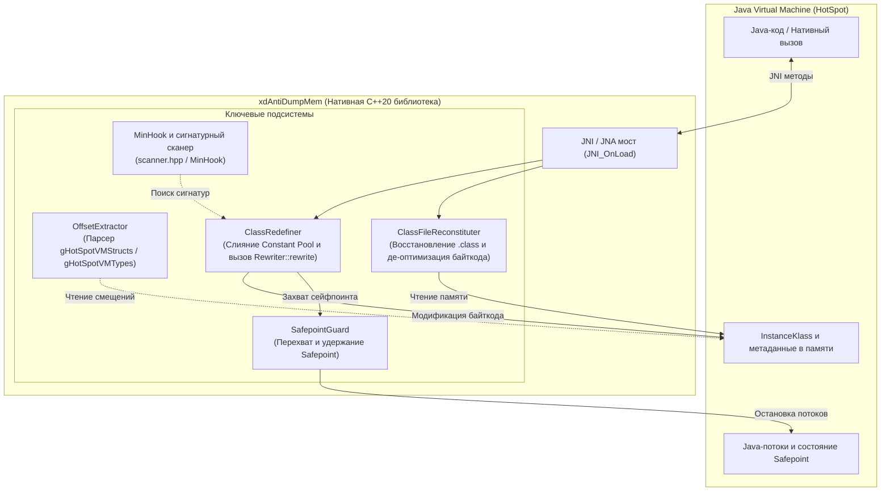

# xdAntiDumpMem (Custom JNA)

<p align="center">
  <b>Высокопроизводительный C++20 движок интроспекции рантайма HotSpot JVM, деобфускации/дампа байткода и горячего переопределения классов</b>
</p>

<p align="center">
  <a href="README.md"></a>
  <a href="README_RU.md"></a>
  
  
  
  
</p>

---

## 🌐 Навигация по языкам
- **English**: [README.md](README.md)
- **Русский**: [README_RU.md](README_RU.md)

---

## 📖 Обзор проекта

**xdAntiDumpMem** (внутреннее рабочее имя: `custom_jna`) — это низкоуровневая нативная библиотека на современном C++20 для Windows x64. Проект напрямую взаимодействует с внутренними структурами **OpenJDK HotSpot VM** (версии 17–21+) без необходимости сборки JVM с отладочными символами и в обход стандартных ограничений JVMTI / Instrumentation API.

Библиотека создана для реверс-инжиниринга, исследований безопасности рантаймов и систем низкоуровневой модификации Java-приложений:
1. **Обход Anti-Dump защит и дамп классов из памяти**: Полная реконструкция валидных `.class`-файлов напрямую из рантайм-памяти JVM (`InstanceKlass`). Выполняется обратное преобразование внутренних оптимизированных инструкций HotSpot (`fast_*`) в стандартные спецификационные опкоды JVM, благодаря чему восстановленный байткод можно открывать в любых декомпиляторах (CFR, Procyon, Fernflower, IntelliJ IDEA).
2. **Произвольное горячее переопределение классов (Hot-Patching)**: Модификация классов прямо в памяти на лету. Включает потокобезопасную синхронизацию через `SafepointGuard` с симуляцией фиктивного `VM_Operation`, слияние пулов констант (Constant Pool Merge), расширение индексов `ldc` -> `ldc_w` и вызов нативного механизма HotSpot `Rewriter::rewrite`.
3. **Прямой доступ к памяти (JNA Engine)**: Чтение и запись значений полей объектов и статических полей любых типов (`int`, `long`, `float`, `double`, `boolean`, `object reference`) напрямую по смещениям в обход Java Reflection, модификаторов `private`/`final` и проверок SecurityManager.
4. **Управление флагами JVM и верификатором байткода**: Возможность динамического включения и отключения проверки байткода (Verifier) во время работы процесса.

---

## 🏛️ Архитектура



---

## ✨ Ключевые возможности

### 1. Динамическое извлечение смещений через VMStructs
Вместо захардкоженных смещений, которые ломаются при каждом минорном апдейте JDK, `xdAntiDumpMem` на этапе инициализации парсит экспортируемые HotSpot таблицы `gHotSpotVMStructs` и `gHotSpotVMTypes` в модуле `jvm.dll`.
- Автоматически определяются структуры ООП: `InstanceKlass`, `ConstantPool`, `ConstantPoolCache`, `Method`, `ConstMethod`, `Symbol`, `Array<T>`.
- Полная поддержка компактных структур полей (`FieldInfoReader` для `fieldinfo_stream`), появившихся в современных релизах OpenJDK (16+ / 20+).

### 2. Реконструкция байткода из памяти (`klassReconstruct`)
В процессе работы HotSpot компилирует и переписывает байткод методов, заменяя стандартные опкоды на собственные быстрые инструкции (например: `_fast_agetfield`, `_fast_invokevfinal`, `_fast_linearswitch`, `_fast_aload_0`), а также модифицируя ссылки на ConstantPoolCache. Из-за этого обычный дамп памяти возвращает битый файл, вызывающий ошибки декомпилятора.

Модуль `ClassFileReconstituter` решает эту проблему:
- **Де-оптимизация инструкций**: Конвертирует быстрые опкоды HotSpot обратно в стандартные инструкции спецификации JVM (`getfield`, `putfield`, `invokevirtual`, `invokespecial`, `tableswitch` и т.д.).
- **Сборка Constant Pool**: Корректно воссоздает все теги константного пула (`Utf8`, `Integer`, `Float`, `Long`, `Double`, `Class`, `String`, `Fieldref`, `Methodref`, `InterfaceMethodref`, `NameAndType`, `MethodHandle`, `MethodType`, `Dynamic`, `InvokeDynamic`).
- **Восстановление атрибутов**: Генерирует атрибуты `Code`, `LineNumberTable`, `Exceptions`, `InnerClasses`, `EnclosingMethod`, `NestHost`, `NestMembers`, `PermittedSubclasses` и `Record`.

### 3. Безопасное переопределение классов на лету (`klassRedefine`)
Позволяет изменять тела методов и структуру классов без ограничений стандартного JVMTI:
- **`SafepointGuard`**: Модификация структур `InstanceKlass` из JNI-потока во время параллельного выполнения методов Java-потоками обычно приводит к сбоям (Access Violation). `SafepointGuard` переводит виртуальную машину в сейфпоинт через сигнатуры функций `SafepointSynchronize::begin()` и `end()`. Для предотвращения падения при обращении к пустому объекту текущей операции конструируется фиктивный `VM_Operation` (тип 42 `RedefineClasses`), полностью удовлетворяющий виртуальную таблицу HotSpot.
- **Слияние Constant Pool**: Добавляет новые константы в существующий пул класса, пересчитывая индексы.
- **Расширение `ldc` до `ldc_w`**: Если при добавлении новых констант индекс выходит за пределы 1 байта (255), инструкция автоматически расширяется.
- **Вызов нативного `Rewriter`**: Вызывает нативную функцию HotSpot `Rewriter::rewrite(InstanceKlass*, Thread*)` для корректной привязки кэша констант.

### 4. Прямой доступ к памяти (JNA-таблица)
Вектор функций `JNINativeAccess_` предоставляет моментальный доступ к внутренностям:
- Поиск: `findClass`, `findFieldId`, `findMethod`.
- Быстрый get/set для примитивов и ссылок на объекты как для обычных полей, так и для `static`.
- Управление верификатором байткода (`setKlassBytecodeVerification`).

---

## 🛠️ Сборка проекта

### Требования
- **ОС**: Windows 10/11 x64
- **Компилятор**: MSVC v143 (Visual Studio 2022) с поддержкой C++20
- **Система сборки**: CMake 3.20+ (поддерживается CMake 4.0)
- **JDK**: Java Development Kit 17 или 21+ (x64)

### Команды для сборки

В терминале PowerShell:
```powershell
# Клонирование репозитория
git clone https://github.com/dino939/custom_jna.git
cd custom_jna

# Генерация файлов сборки CMake
cmake -B build -S . -DCMAKE_BUILD_TYPE=Release

# Сборка DLL библиотеки
cmake --build build --config Release
```

Собранная динамическая библиотека `xdAntiDumpMem.dll` будет находиться в папке `build/Release/`.

---

## 🚀 Примеры использования

### 1. Подключение через Java JNI

При загрузке библиотеки вызовом `System.loadLibrary("xdAntiDumpMem")` или `System.load(...)`, нативный метод `JNI_OnLoad` регистрирует методы в классе `das.ist.denger.systems.jvm.JvmInterface` или `org.example.Main`.

#### Пример на Java:
```java
package das.ist.denger.systems.jvm;

import java.io.FileOutputStream;
import java.io.IOException;

public class JvmInterface {
    static {
        System.load("D:/cpp-projects/Jvm-api/build/Release/xdAntiDumpMem.dll");
    }

    // Дампит загруженный в память класс в виде валидного массива байт .class
    public static native byte[] klassReconstruct(Class<?> klazz);

    // Переопределяет класс в памяти новыми байтами на лету
    public static native boolean klassRedefine(Class<?> klazz, byte[] newBytes);

    public static void main(String[] args) throws IOException {
        // Пример 1: Дамп защищенного/загруженного класса
        byte[] dumpedBytes = klassReconstruct(TargetClass.class);
        try (FileOutputStream fos = new FileOutputStream("TargetClass_dumped.class")) {
            fos.write(dumpedBytes);
        }
        System.out.println("Класс успешно сдамплен! Размер: " + dumpedBytes.length + " байт");

        // Пример 2: Горячая подмена байткода класса
        boolean success = klassRedefine(TargetClass.class, dumpedBytes);
        System.out.println("Результат переопределения: " + success);
    }
}
```

### 2. Использование Native C++ API

Библиотеку можно вызывать напрямую из C++ (например, при инжекте в целевой процесс с HotSpot):

```cpp
#include "jvm/jna/JNABootStrap.h"
#include "jvm/jna.h"

void inspectJvm() {
    environment env = JNABootStrap::getInstance()->getEnv();

    // Поиск класса в структурах JVM
    InstanceKlass* klass = env->findClass("com/example/ProtectedService");
    if (klass) {
        // Восстановление байткода класса
        std::vector<uint8_t> classBytes = env->reconstructClass(klass);

        // Отключение верификатора байткода при необходимости
        env->setKlassBytecodeVerification(false);

        // Горячая замена класса
        bool ok = env->redefineClass(klass, classBytes);
    }
}
```

---

## 📁 Структура каталогов

```
.
├── CMakeLists.txt                    # Скрипт сборки CMake
├── main.cpp                          # Точка входа JNI (JNI_OnLoad и регистрация функций)
├── minhook/                          # Библиотека перехвата API MinHook (x86/x64)
├── utils/
│   ├── scanner.hpp                   # Сигнатурный сканер шаблонов байт в памяти
│   └── bytecodeRewriter.h            # Утилиты перезаписи потоков байткода
└── jvm/
    ├── types.h                       # Базовые типы данных JVM, смещения и флаги
    ├── jna.h                         # Таблица указателей на функции (JNINativeAccess_)
    ├── jna/
    │   ├── JNABootStrap.cpp/.h       # Синглтон JNA и фабрика окружения
    │   └── JvmFunctions.cpp/.h       # Высокоуровневые методы доступа к JVM
    ├── jni/
    │   ├── jni.h / jni_md.h          # Заголовочные файлы JNI
    │   └── JniJnaConnector.cpp/.h    # Преобразование jclass <-> InstanceKlass*
    ├── offset/
    │   └── OffsetExtractor.cpp/.h    # Парсер HotSpot VMStructs
    ├── pattern/
    │   └── patterns.h                # Байт-паттерны (Safepoint, Rewriter, SymbolTable)
    ├── reconstruct/
    │   ├── bytecodeTables.h          # Карты опкодов и таблицы соответствия инструкций
    │   └── classFileReconstituter.cpp/.h # Модуль восстановления .class из памяти
    ├── redefine/
    │   ├── SafepointGuard.cpp/.h     # RAII синхронизатор сейфпоинта HotSpot
    │   └── classRedefiner.cpp/.h     # Слияние Constant Pool, расширение ldc и hot-patching
    ├── struct/                       # Зеркальные структуры данных HotSpot JVM
    │   ├── vmStructs.hpp             # Представление записей VMStruct
    │   ├── thread/                   # Представление JavaThread
    │   ├── runtime/flags/            # Структуры JVMFlag
    │   └── oop/                      # Модели объектов HotSpot:
    │       ├── array/                # Array<T>
    │       ├── constantPool/         # ConstantPool, ConstantPoolCache, Indy
    │       ├── klass/                # InstanceKlass, InnerClasses, Record
    │       ├── method/               # Method, ConstMethod, ExceptionTable
    │       └── symbol/               # Symbol & SymbolHash
    └── utils/
        ├── assert/assert.hpp         # Внутренняя система ассертов
        └── fields/Fieldinfo.hpp      # Парсер compact fieldinfo для OpenJDK
```

---

## 🔒 Отказ от ответственности (Security Disclaimer)

> [!CAUTION]
> Проект разработан исключительно в образовательных целях, для анализа защищенности ПО, исследований совместимости и авторизованного аудита безопасности. Не используйте данное ПО на системах и приложениях без явного согласия их правообладателей.

---

## 📄 Лицензия

Проект распространяется под лицензией MIT. Подробности см. в файле LICENSE.
